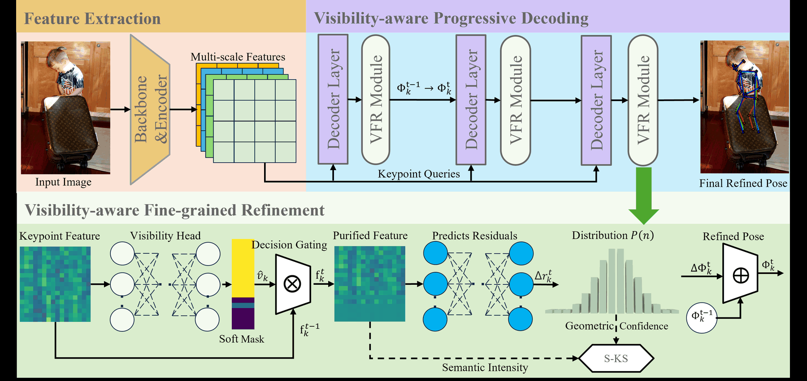
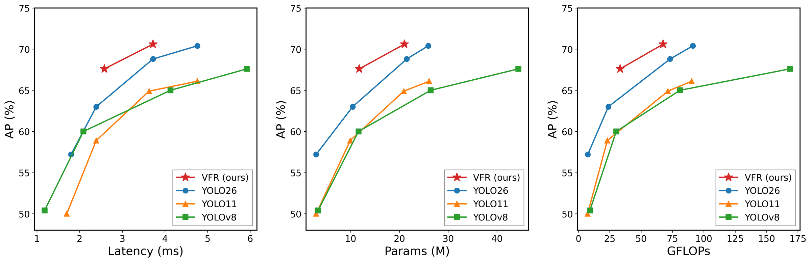

# VFR: Visibility-aware Fine-grained Refinement

**Visibility-aware Fine-grained Refinement for Lightweight Multi-Person Pose Estimation**

VFR integrates joint visibility into the iterative refinement of an end-to-end
multi-person pose estimator. It regulates each new distribution residual using
the reliability of its supporting features, while preserving evidence accumulated
in previous decoder layers.

This repository provides **VFR-S and VFR-M pretrained inference models**, single-image
prediction with visualization, and reproducible **COCO val2017 evaluation**.

Official repository: [eplius/VFR](https://github.com/eplius/VFR).

[Overview](#overview) | [Results](#results) | [Installation](#installation) |
[Models](#pretrained-models) | [Inference](#image-inference) |
[COCO Evaluation](#coco-val2017-evaluation)

## Overview



**Figure 1. Overview of the proposed framework.** The decision gate is the
temperature-scheduled soft gate in VFR. It uses predicted visibility inside each
decoder layer to regulate the residual distribution update, while S-KS supplies
reliability-aligned pose-quality supervision after assignment.

The method consists of three complementary ideas:

- **Visibility-aware refinement:** a lightweight joint-wise visibility head produces
  a soft gate after contextual feature interaction. The gated features predict the
  next residual; the accumulated distribution logits are not masked or rescaled.
- **Semantic-Keypoint Similarity (S-KS):** geometric agreement and contextual evidence
  form a post-assignment pose-quality target. Hungarian assignment is unchanged.
- **Poly-QGV supervision:** polynomial compensation addresses imbalanced visibility
  supervision during training, supporting learning for occluded joints.

Only the trained forward path is needed at inference. S-KS target construction,
Poly-QGV loss, and the training schedule do not run in this release. The trained
soft-gate constants are stored in each exported model.

## Results

### Paper results

**Table 2. Performance comparison on COCO val2017.** Best results among
lightweight end-to-end methods are shown in **bold**; within each block, rows
above the separator list larger models, and rows below list lightweight models.
The marked "Lightweight models" rows below serve as the manuscript's separators.

**Non-end-to-end methods**

| Method | Backbone | Parameters (M) | AP | AP<sub>50</sub> | AP<sub>75</sub> | AP<sub>M</sub> | AP<sub>L</sub> | AR |
| --- | --- | ---: | ---: | ---: | ---: | ---: | ---: | ---: |
| DirectPose | ResNet-50 | - | 63.1 | 85.6 | 68.8 | 57.7 | 71.3 | - |
| CenterNet | Hourglass-104 | 194.9 | 64.0 | - | - | - | - | - |
| FCPose | ResNet-101 | 60.5 | 63.0 | 85.9 | 68.9 | 59.1 | 70.3 | - |
| InsPose | ResNet-50 | 50.2 | 63.1 | 86.2 | 68.5 | 58.5 | 70.1 | - |
| **Lightweight models** | | | | | | | | |
| YOLOv8-S | CSPDarknet | 11.6 | 60.0 | 86.2 | 65.9 | 53.8 | 70.2 | 66.7 |
| YOLOv8-S\* | CSPDarknet | 11.6 | 59.9 | 85.8 | 65.9 | 53.7 | 70.1 | 66.3 |
| YOLO11-S | CSPDarknet | 9.9 | 58.9 | 86.2 | 64.8 | 54.0 | 67.9 | 66.1 |
| YOLO11-S\* | CSPDarknet | 9.9 | 58.7 | 85.9 | 64.5 | 53.8 | 67.8 | 65.6 |
| RTMO-S | CSPDarknet | 9.9 | 67.7 | 87.8 | 73.7 | - | - | 71.5 |

**End-to-end methods**

| Method | Backbone | Parameters (M) | AP | AP<sub>50</sub> | AP<sub>75</sub> | AP<sub>M</sub> | AP<sub>L</sub> | AR |
| --- | --- | ---: | ---: | ---: | ---: | ---: | ---: | ---: |
| PETR | ResNet-50 | 43.7 | 68.8 | 87.5 | 76.3 | 62.7 | 77.7 | - |
| GroupPose | ResNet-50 | 52.4 | 72.0 | 89.4 | 79.1 | 66.8 | 79.7 | 72.0 |
| DETRPose-L | HGNetv2-B4 | 32.8 | 72.5 | 90.6 | 79.0 | - | - | 78.7 |
| **Lightweight models** | | | | | | | | |
| YOLO26-S | CSPDarknet | 10.4 | 63.0 | 86.6 | - | - | - | - |
| DETRPose-S | HGNetv2-B0 | 11.51 | 67.0 | **87.6** | 72.8 | - | - | 73.5 |
| VFR-S | HGNetv2-B0 | 11.75 | **67.6** | **87.6** | **73.4** | **61.2** | **77.7** | **74.2** |

Numbers, missing entries (`-`), asterisk markers, and bold emphasis are retained
from Table 2 of the manuscript. These are the paper's comparison results, not
new measurements of every method using this inference package.

### Accuracy and efficiency



**Figure 4. Comparisons with lightweight pose estimation models in terms of latency,
AP, parameter count, and GFLOPs on COCO val2017.** End-to-end latency is averaged
over 1,000 TensorRT v10.12 FP16 runs with batch size 1 on a single NVIDIA GeForce
RTX2080Ti GPU.

| Model | COCO AP | Parameters (M) | GFLOPs | TensorRT latency (ms) |
| --- | ---: | ---: | ---: | ---: |
| YOLOv8-N | 50.4 | 3.3 | 9.2 | 1.18 |
| YOLOv8-S | 60.0 | 11.6 | 30.2 | 2.09 |
| YOLOv8-M | 65.0 | 26.4 | 81.0 | 4.13 |
| YOLOv8-L | 67.6 | 44.4 | 168.6 | 5.92 |
| YOLO11-N | 50.0 | 2.9 | 7.4 | 1.70 |
| YOLO11-S | 58.9 | 9.9 | 23.1 | 2.39 |
| YOLO11-M | 64.9 | 20.9 | 71.4 | 3.63 |
| YOLO11-L | 66.1 | 26.1 | 90.3 | 4.76 |
| YOLO26-N | 57.2 | 2.9 | 7.5 | 1.80 |
| YOLO26-S | 63.0 | 10.4 | 23.9 | 2.39 |
| YOLO26-M | 68.8 | 21.5 | 73.1 | 3.72 |
| YOLO26-L | 70.4 | 25.9 | 91.3 | 4.76 |
| VFR-S | **67.6** | 11.75 | 33.3 | 2.58 |
| VFR-M | **70.6** | 21.02 | 67.58 | 3.72 |

The efficiency table lists the data used to plot Figure 4, with the N/S/M/L
variants shown individually. YOLOv8 and YOLO11 use NMS; YOLO26 and VFR are
end-to-end and NMS-free. The figure data and manuscript table values are retained;
only the web image resolution and PNG palette are optimized for faster loading.
The latency column describes the **paper's TensorRT FP16 benchmark**, not the runtime of the
TorchScript evaluator below. This package does not include TensorRT engines,
export tools, or the TensorRT benchmark. Parameter and operation counts follow
the paper's reporting convention, not serialized file size.

### Verified release evaluation

| Model | COCO AP | Evaluation batch | Position embedding | Forward precision |
| --- | ---: | ---: | --- | --- |
| VFR-S | [67.6](reports/coco_s.json) | 1 | legacy | CUDA AMP FP16 |
| VFR-M | [70.6](reports/coco_m.json) | 12 | current, non-in-place | FP32 |

Release results were measured on all 5,000 COCO val2017 images on an RTX 2080 Ti,
using the model-specific settings above. The table rounds to one decimal place;
the JSON reports retain the measured values (67.5522 and 70.5719 AP). Both results
reproduce the paper's one-decimal AP.
See [validation notes](reports/README.md) for output-parity tests and provenance.
The position-embedding and precision settings are frozen in the graphs. The S
asset is an AMP deployment profile, not a claim that the original validation
function enabled AMP. The M evaluation batch matches its original configuration.

- RGB, direct bilinear resize to 640 x 640, pixel range [0, 1]. No letterbox,
  ImageNet normalization, flip test, multi-scale test, or NMS.
- Keep all top-60 query/class scores per image before COCO evaluation.
- Original-image coordinates, 17 COCO keypoints, category 1, COCO maxDets=20.
- Visibility is an internal refinement signal; the third output keypoint value
  follows the original postprocessor (1), not a calibrated joint confidence.
- Checkpoint epoch, selected EMA weights, and soft-mask constants are fixed
  at export. No training schedules run during inference.

## Installation

Tested environment: **Linux, Python 3.11, PyTorch 2.4.0, CUDA 12.1**.
Use a CUDA-capable GPU and an appropriate NVIDIA driver. From the repository root:

```bash
git clone https://github.com/eplius/VFR.git
cd VFR
python -m venv .venv
source .venv/bin/activate
python -m pip install torch==2.4.0 --index-url https://download.pytorch.org/whl/cu121
python -m pip install -r requirements.txt
```

The CUDA wheel command follows the [official PyTorch version guide](https://pytorch.org/get-started/previous-versions/#v240).
The four direct dependencies are pinned to the versions used for validation:

| Dependency | Version | Purpose |
| --- | --- | --- |
| PyTorch | 2.4.0 | Load and execute the TorchScript graphs on CUDA |
| NumPy | 1.26.4 | Image-array conversion |
| Pillow | 11.1.0 | Image loading, resizing, and skeleton visualization |
| pycocotools | 2.0.10 | COCO annotations and official keypoint metrics |

PyTorch installs its own transitive dependencies. `torchvision`, OpenCV, SciPy,
OmegaConf, TensorRT, and the private training code are **not required** by these
inference/evaluation entry points. No custom CUDA extension needs to be compiled.

## Pretrained models

**Model downloads are pending.** The inference/evaluation code, model manifests,
and verified results are public. The two `.pt` files will be attached separately
to a [GitHub Release](https://github.com/eplius/VFR/releases); the code requires
these files to run. The JSON manifests alone do not contain model weights.

Place the model assets in `weights/`, alongside their JSON manifests:

| Model | Inference artifact | Manifest |
| --- | --- | --- |
| VFR-S | `weights/vfr_s_coco.pt` | [Settings and SHA-256](weights/vfr_s_coco.json) |
| VFR-M | `weights/vfr_m_coco.pt` | [Settings and SHA-256](weights/vfr_m_coco.json) |

The `.pt` assets are distributed separately from Git history. Each contains the
inference graph and trained parameters, without optimizer state or training data.
The runtime verifies the artifact's SHA-256 before loading it. Load only files
from a trusted publisher: TorchScript artifacts are executable models, and a
checksum alone does not establish trust.

These CUDA exports support single-image inference and the evaluation batches
listed above. CPU, ONNX, and TensorRT are not covered by this release.

## Image inference

```bash
CUDA_VISIBLE_DEVICES=0 python infer.py --model s --input /path/to/image.jpg \
  --output results/vfr_s.json --visualize results/vfr_s.jpg

CUDA_VISIBLE_DEVICES=0 python infer.py --model m --input /path/to/image.jpg \
  --output results/vfr_m.json --visualize results/vfr_m.jpg
```

Each command saves prediction JSON and an optional skeleton overlay. Choose a
physical GPU with `CUDA_VISIBLE_DEVICES`; the graph uses logical `cuda:0`.
Use `--weights-dir /path/to/weights` when storing the assets elsewhere.

Each prediction contains `category_id`, `score`, and 17 COCO keypoints in flattened
`[x, y, v, ...]` format, in original-image coordinates. The optional `--threshold`
controls visualization only; it does not remove predictions from JSON or affect AP.

## COCO val2017 evaluation

Download COCO val2017 images and `person_keypoints_val2017.json` separately.
The dataset and annotations are not included or redistributed.
The expected layout is:

```text
COCO2017/
  val2017/
    000000000139.jpg
    ...
  annotations/
    person_keypoints_val2017.json
```

The evaluator reads each model's reference batch size from its JSON manifest.
Keep this default to reproduce the reported results; batch-dependent floating-point
differences can affect ranking and thresholded OKS metrics.

```bash
CUDA_VISIBLE_DEVICES=0 python evaluate.py --model s \
  --images /path/to/COCO2017/val2017 \
  --annotations /path/to/COCO2017/annotations/person_keypoints_val2017.json \
  --output results/vfr_s_coco

CUDA_VISIBLE_DEVICES=0 python evaluate.py --model m \
  --images /path/to/COCO2017/val2017 \
  --annotations /path/to/COCO2017/annotations/person_keypoints_val2017.json \
  --output results/vfr_m_coco
```

To evaluate both models sequentially:

```bash
COCO_ROOT=/path/to/COCO2017 bash evaluate_coco.sh
```

Use a new output directory for each run. `--limit 10` is a smoke check, **not**
a reproducible full-dataset AP result. Each run saves `predictions.json` and
`metrics.json` with weight/annotation hashes and evaluation settings.

## Repository contents

```text
assets/             # Paper framework and efficiency figures
weights/            # Model manifests; place separately supplied .pt assets here
reports/            # COCO metrics, parity checks, and environment versions
runtime.py          # Preprocessing, model loading, and postprocessing
infer.py            # Single-image prediction and visualization
evaluate.py         # COCO val2017 evaluation
evaluate_coco.sh    # Sequential S/M evaluation
requirements.txt    # Minimal, pinned runtime dependencies
LICENSE
NOTICE
```

## Publication scope and attribution

This is an **inference/evaluation release**, not a complete training-reproduction
release. It does not include training recipes, losses, optimizers, or an
independently editable Python model definition. Training-only S-KS and Poly-QGV
are described above to explain the method; they are not dependencies of inference.

The model is derived from [DETRPose](https://github.com/SebastianJanampa/DETRPose).
Retain `LICENSE` and `NOTICE` when redistributing this release. Training-only
S-KS matching and Poly-QGV supervision are not required to execute a trained
forward graph; their absence here is not a claim that they were absent in training.

For preparing a public repository and attaching model assets, see
[Publishing](PUBLISHING.md).
